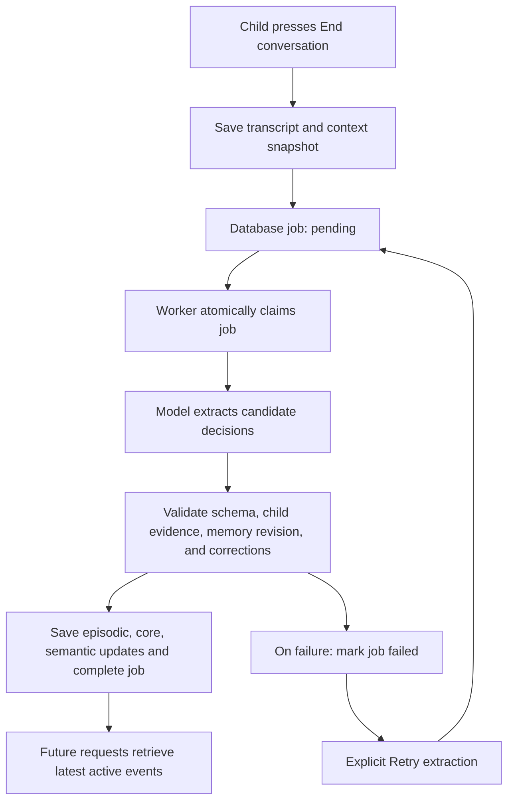

# Monty: agent memory and prompt context flow

This document describes the current implementation. Here, **context injection** means adding application data and conversation turns to a model request. It does not mean promoting saved text to trusted system instructions.

## Memory layers

| Layer | Storage | What reaches the model |
| --- | --- | --- |
| Short-term conversation | React state and per-child browser `sessionStorage` | Every prior user and Monty message in the active conversation, in order |
| Financial history | Database goals, transactions, impulse scores, and decision logs | A bounded, deterministically queried snapshot |
| Long-term decision events | Database `decision_events` table | The five most recent active events for the child, with evidence quotes |
| Core memory | Versioned `children.core_memory` JSON state | All four supported preference categories, when present, as compact context |
| Semantic memory | Revisioned `semantic_memories` table | Up to five active explicit facts matched to the current query |
| Ended conversation archive | Database `ended_conversations` table | Full transcript during extraction; not automatically replayed in future chats |

This is structured event and SQL text retrieval, not an embedding/vector-search system. The older `Memory` model is not used by this workflow; the legacy memories endpoint still returns an empty list. New core and semantic state is injected through the shared context builder, not that endpoint. The agent does not update its model weights or infer cross-conversation personality or behavioral profiles.

## 1. Chat and short-term memory

The child talks to Monty in the Kid dashboard's Monty tab. The frontend stores messages, a conversation UUID, and extraction status in browser session storage under keys derived from `monty_chat_{child_id}`. History survives navigation and reloads in that browser tab; it is not an account-synchronized conversation store.

Each submission calls:

```http
POST /api/coaching/chat
```

The body contains `child_id`, the current `message`, optional `context`, and `history` entries with `role` (`user` or `assistant`) and `content`. History contains prior messages; the current message is supplied separately and appears once in the generated request.

The backend validates the input and checks that the child exists, builds the current database snapshot, and sends one structured generation request. The backend does not save ordinary chat turns as they arrive. Failed sends are removed from the displayed history and restored to the input for retry.

Source: [KidMonty.tsx](frontend/src/dashboard/kid/KidMonty.tsx), [client.ts](frontend/src/api/client.ts), [chat endpoint](backend/app/api/v1/endpoints/coaching.py).

## 2. Deterministic financial context

[ai_context_service.py](backend/app/services/ai_context_service.py) queries only the selected child's records. It includes:

| Context section | Selection and contents |
| --- | --- |
| `profile` | Name and age |
| `coverage` | Explicit 30-day window, UTC timezone limitation, and unknown historical currency |
| `goals` | Up to five active goals ordered by ID, with target, saved, remaining, and weekly contribution amounts |
| `spending` | Purchase count and total over the entire 30-day window, excluding deposits |
| `recent_purchases` | Latest eight purchases in that window |
| `impulse_summary` | Assessment count, valid-score count, average valid score, and count scoring at least 70 over the entire window |
| `historical_assessments` | Latest eight assessments with product, price, merchant/category, score, factors, and child response |
| `positive_decisions` | Latest two decision logs in that window with responses `waited`, `paused`, `delayed`, `skipped`, or `agreed_to_wait` |
| `decision_events` | Latest five active extracted events, without a 30-day lower bound; includes action, outcome status, situation, source, goal relationship, and evidence quotes |
| `core_memory` | Schema version, global memory revision, and compact active preferences; always loaded |
| `semantic_memories` | Up to five active explicit facts ranked by current retrieval text; no unrelated recent-memory fallback |
| `proposed_purchase` | Purchase details and prompt when using purchase assessment |

Time-window queries exclude future records. Historical assessment scores outside 0–100 or nonfinite scores are excluded from numerical summaries and exposed as unavailable in sampled context. Remaining goal amounts and aggregates are computed in code/SQL, not generated by the model.

Extracted events exclude superseded records and future recording timestamps. Selection is by recency, not semantic similarity. Their `recorded_at` is the conversation-end recording time, not a verified time when the child performed the action.

Both chat and `POST /api/extension/assess-purchase` use this context builder. Chat retrieval uses the current message and most recent prior user message. Purchase retrieval uses the prompt, product, merchant, and category; the purchase form does not send chat history. Dashboard reads do not initiate Gemini generation.

### Core and semantic memory updates

Core state contains `schema_version: 1`, a `revision`, and `entries`. Its only keys are `communication_style`, `reminder_preference`, `interests`, and `motivations`. Each stored entry contains a value of at most 250 characters, source conversation ID, evidence message IDs/quotes, and update time. The prompt receives compact values and update times; audit evidence remains in storage. Identity and financial fields remain authoritative in their original tables.

At End conversation, the existing extraction request can propose up to four core upsert/removal operations and five semantic upsert/retraction operations in addition to episodic decisions. Empty collections are valid, including conversations with facts/preferences but no decision events. Core updates merge into the existing state; unrelated entries are retained. There is no wholesale model rewrite.

Semantic records store a stable key, name, topic, summary, optional details, explicit origin, source conversation, evidence, revision, status, and superseded-record ID. Corrections create new revisions, and retractions create an audited inactive revision. Unchanged core values and exact duplicate active semantic content do not create new revisions. Paraphrase-level deduplication is not guaranteed.

All new memory operations require verbatim evidence from the saved transcript's child messages. Duplicate/conflicting operations for a key are rejected. Excluding hypotheses, inferred traits, credentials, and unsupported claims is also part of the extraction instructions; quote validation alone cannot establish semantic truth.

The worker applies core, semantic, and episodic changes in one transaction. A child-row lock and global memory revision check reject stale proposals rather than overwrite concurrent changes. A failed job can be explicitly retried to retrieve fresh state. No extra model call is added for routing to these memory categories.

### Deterministic semantic retrieval

Text is lowercased, split into word tokens, filtered for common English stopwords and tokens shorter than two characters, deduplicated, and capped at 20 terms. SQL scoring assigns each matching term weight 4 in the name, 2 in the topic, and 1 each in summary and details. Queries use bound, escaped matching expressions and filter by child and active status before selection. Positive scores sort descending, then newest update, then ID. Chat/purchase use the top five; extraction uses up to 20 candidates matched against saved child messages. Empty queries and no matches return no semantic records.

This is substring-based keyword ranking, not BM25 or embedding similarity. It can miss synonymous phrasing. Extraction must reuse supplied keys when correcting matching facts; attempting to modify an active semantic record absent from its snapshot fails safely.

Implementation: [memory service](backend/app/services/memory_service.py), [SQL retrieval](backend/app/repositories/semantic_memory_repo.py), [memory schemas](backend/app/schemas/memory.py), and [semantic model](backend/app/models/semantic_memory.py).

## 3. Model request assembly

[ai.py](backend/app/core/ai.py) assembles the request in this order:

1. **System instruction:** shared Monty personality plus task-specific instructions.
2. **First user content:** JSON containing `facts`, `allowed_evidence_refs`, and `request_context`.
3. **Chat history:** every supplied prior turn, mapping `assistant` to the SDK's `model` role.
4. **Final user content:** the current message, or the task instruction when no message is supplied.

Financial and retrieved memory data remain context, not system policy. The prompt treats messages, merchant text, previous model replies, and evidence quotes as untrusted content. Prior assistant replies are not authoritative financial facts.

Monty is instructed to answer the latest question, avoid repetitive balances/praise, and mention past positive decisions only when useful. It must distinguish agreeing to pause from actually waiting or skipping. Historical risk assessments and self-reported decisions are not confirmed purchases or calibrated probabilities.

Responses use task-specific JSON schemas and Pydantic validation. Chat/risk orchestration also rejects evidence references that are not in the allowed context. These checks validate structure and reference membership; they do not prove every generated claim is correct.

Memory extraction sends a compact provider schema with types, enums, required fields, and object structure. String/array bounds and patterns remain enforced by the full Pydantic schema before any memory writes, avoiding Gemini's rejection of the expanded constrained schema. A provider `400` is reported as a request configuration/schema error and is not automatically retried. Previously failed extraction jobs remain saved and need an explicit retry after the fix is loaded.

The default input budget is approximately **10,000 tokens**, estimated locally from UTF-8 size, instructions, and schema. No remote token-counting call occurs. Oversized requests return `422` without silently truncating history. Default maximum output is 1,200 tokens for responses and 2,400 for memory extraction (`AI_MEMORY_EXTRACTION_MAX_OUTPUT_TOKENS`); the overall provider deadline is 15 seconds. Environment settings can override supported values. Learned memories remain untrusted context, not developer instructions; current explicit user corrections take precedence over older preferences during chat.

Normal generation uses one provider request, with at most one retry for selected transient server errors. A `429` is not immediately retried. Actual usage metadata is logged after successful generation.

## 4. Ending a conversation and extracting events



The End conversation button sends the full transcript, message IDs, child ID, and conversation UUID to:

```http
POST /api/coaching/conversations/end
```

It returns `202` after saving the transcript and current financial snapshot. It does not wait for the model. Repeating the same ID and transcript reuses the existing job; changing the transcript for an already saved ID returns `409`.

The UI polls the status endpoint every three seconds while the job is pending or processing. New conversation starts a separate browser conversation after the previous conversation has been saved; extraction can continue in the background.

The worker starts through FastAPI's lifespan when `AI_EXTRACTION_WORKER_ENABLED=true` (the default). It uses independent database sessions and releases connections before awaiting the provider. It checks approximately every five seconds while idle and every second after handling work. Processing jobs abandoned for more than five minutes can be reclaimed. Failed jobs require an explicit retry; retry refreshes the financial snapshot while retaining the saved transcript.

Source: [decision_extraction.py](backend/app/services/decision_extraction.py), [conversation endpoints](backend/app/api/v1/endpoints/conversations.py), [application lifecycle](backend/app/main.py).

## 5. Extracted event meaning and validation

The extractor can return zero to five candidates. Zero is a valid successful result when no financial decision occurred.

| Field | Meaning |
| --- | --- |
| `action` | `wait`, `skip_purchase`, `purchase`, `save`, or `other` |
| `outcome_status` | `commitment` or `reported_completed` |
| `source` | Application-assigned `child_self_report` |
| `goal_relationship` | `potentially_supportive`, `potentially_conflicting`, or `unclear` |
| `evidence` | Message IDs and exact quotes supporting the event |
| `status` | `active` or `superseded` |
| `supersedes_event_id` | A referenced earlier event explicitly corrected by the child |

For example, “I will wait until tomorrow” supports a commitment. “I waited and decided not to buy it” can support a reported completed outcome. Neither is independent verification by a bank or transaction provider.

The prompt excludes hypothetical questions, assistant-only suggestions, unrelated sensitive information, and personality judgments. Code requires each evidence quote to occur verbatim in a referenced **user** message. All candidates are validated before writing; invalid evidence fails the job rather than saving partial results. Semantic interpretation remains model-dependent: an exact quote alone does not prove the classification is correct.

Candidates with the same action, status, and evidence are deduplicated within the job. Corrections can reference only events included in the saved context, must belong to that child and remain active, and supersede the earlier event atomically. This is not a general deduplication system across all conversations or an automated review of all older memories.

## 6. Storage, endpoints, and operation

| Table | Stored content |
| --- | --- |
| `ended_conversations` | Immutable transcript, hash, context snapshot, job state, attempts, processing lease, and error |
| `decision_events` | Extracted action/outcome, evidence, source, recording time, correction link, fingerprint, and extractor version |
| `children.core_memory` | Versioned recursive preference state; new children and migrated rows start empty |
| `semantic_memories` | Explicit reusable knowledge, evidence, source, revisions, and active/superseded/retracted status |

The transcript archive is not automatically injected into later conversations. Core state and bounded active event/semantic selections are retrieved. Saving memories never moves money or creates confirmed transactions. No existing transcript or legacy seeded memory is automatically backfilled into the new stores.

```http
GET /api/child/{child_id}/conversations/{conversation_id}/extraction
POST /api/child/{child_id}/conversations/{conversation_id}/extraction/retry
```

Status responses contain `conversation_id`, `status`, `event_count`, and `error`. `event_count` still counts episodic decisions only, not core or semantic updates. The retry endpoint requeues failed jobs. Status polling and database retrieval consume no Gemini quota; extraction is a separate generation workflow from chat, normally one request with at most one transient-error retry.

Latest migration: `c42f8e91d703` (after `a91c4d02b671`). It adds one JSONB-compatible child column and one semantic table, leaving legacy tables intact. From `backend`, with the environment activated:

```powershell
python -m alembic upgrade head
python -m uvicorn app.main:app --reload --port 8000
```

Query saved events in Neon or through the configured SQL connection:

```sql
SELECT id, child_id, action, outcome_status, situation, evidence, status
FROM decision_events
ORDER BY created_at DESC
LIMIT 20;
```

Run mocked backend checks from the project root:

```powershell
.\.venv\Scripts\python -m pytest backend/tests/ai -q
```

Tests cover history preservation, child scoping, evidence validation, duplicate submissions, empty extraction, correction handling, retry context refresh, stale-job recovery, and exclusive job claims without making live Gemini calls.

## Current limitations

- Child-ID scoping is implemented, but `require_child` checks existence rather than authenticated household ownership; authentication integration remains separate work.
- Until End conversation is submitted successfully, the transcript lives in the browser rather than the database. Closing the tab does not automatically save or extract it.
- There is no vector retrieval, conversation summarization, automatic expiry, forgetting UI, or full transcript restoration from the database.
- A failed or oversized extraction leaves the transcript saved but commits no new episodic/core/semantic changes. A completed extraction may legitimately create zero decision events while saving preferences or facts.
- New memories may not appear in a prompt sent before extraction completes. Retrieval includes all compact core preferences, up to five matched semantic records, and the five latest active extracted events.
- Only explicit statements are activated as core/semantic memories. Cross-conversation pattern inference and graph-based consolidation are not implemented.

## Core/semantic implementation file inventory

| Action | File | Responsibility |
| --- | --- | --- |
| Modified | `backend/app/models/child.py` | Persistent core JSON state |
| Modified | `backend/app/models/__init__.py` | Semantic model registration |
| Modified | `backend/app/schemas/decisions.py` | Combined episodic/core/semantic extraction output |
| Modified | `backend/app/services/decision_extraction.py` | Candidate context, validation, and atomic memory writes |
| Modified | `backend/app/services/ai_context_service.py` | Core/semantic injection and evidence references |
| Modified | `backend/app/services/coaching_service.py` | New memory sections as available context |
| Modified | `backend/app/api/v1/endpoints/coaching.py` | Current and previous user message retrieval text |
| Modified | `backend/app/api/v1/endpoints/extension.py` | Purchase-specific retrieval text |
| Modified | `backend/app/core/ai.py` | Memory instructions and extraction output budget |
| Modified | `backend/app/core/config.py` | Output-budget setting and prompt version |
| Modified | `backend/.env.example` | Configuration example |
| Modified | `backend/tests/ai/test_workflow.py` | Empty-memory compatibility checks |
| Modified | `backend/tests/ai/test_provider.py` | Extraction budget and provider call-count checks |
| Modified | `AGENT_MEMORY_FLOW.md` | Current flow and this inventory |
| Created | `backend/app/models/semantic_memory.py` | Revisioned semantic model |
| Created | `backend/app/schemas/memory.py` | Typed core state and memory operations |
| Created | `backend/app/repositories/semantic_memory_repo.py` | SQL text ranking and revision queries |
| Created | `backend/app/services/memory_service.py` | Evidence validation, state merge, and revision handling |
| Created | `backend/alembic/versions/c42f8e91d703_core_and_semantic_memory.py` | One-column, one-table migration |
| Created | `backend/tests/ai/test_memory.py` | Memory and migration regressions |

No frontend, legacy-memory-table, or dependency changes are required by this addition. No new public endpoint or historical-conversation backfill is introduced.
